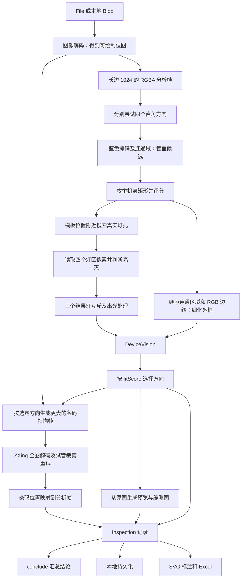

# 核心识别与数据处理：从一张照片到结果的源码学习教程

本文配合 [技术架构总览](TECHNICAL-ARCHITECTURE.md) 阅读。总览介绍系统由哪些模块组成；本文解释模块内部怎样计算、为什么这样计算、如何用真实图片复现。源码基线为 Android 1.0.7 对应的共享代码，核对日期为 2026-09-09。

如果首先想了解“用了哪些技术、有没有 OpenCV”，请先看总览第 3.0 节：当前视觉使用 **Canvas / OffscreenCanvas + 类型化数组 + 项目自写 TypeScript**，条码使用 **zxing-wasm**，没有接入 OpenCV 或深度学习模型。本文接着解释这些技术上运行的具体算法。

文中的公式来自当前实现；标为“教学示例”的数字用于手算，不代表图片实测。b-2 实测来自本地 Node.js + Sharp 调用当前 TypeScript 编译结果，与浏览器 Canvas 的插值和颜色处理可能有小幅差异。本文没有修改运行算法。

建议按第 1～12 节理解算法，再运行第 16 节，最后学习数据存储和调试。第一次阅读可以先略过评分权重，先理解每一步的输入、输出和失败条件。

## 1. 先明确：程序究竟在“识别”什么

这套程序采用**针对特定设备的传统计算机视觉规则**。开发者知道设备有蓝色管盖、长方形机身、固定排列的四个灯，于是把这些先验知识变成搜索范围和评分条件。

“先验”指分析照片前已经知道的设备结构。例如 Negative 在 Positive 左侧，不是从这张照片上的英文文字读出来的。程序没有读取 Negative/Positive 文字来命名灯，也没有向云端大模型提问，没有训练 YOLO 或其他神经网络。

它分开解决三个问题：

| 问题 | 输入证据 | 输出 |
| --- | --- | --- |
| 在哪里 | 蓝色区域、机身内外亮度、几何比例、灯孔与外壳的局部对比 | 机身框、管盖框、四个灯区框 |
| 有没有发光 | 灯区内的 RGB 色差、彩色像素数量、绿色连通区域、其他结果灯强度 | 每个灯的 on/off/unknown、颜色和测量值 |
| 试管编号是什么 | 黑白条码图案，由 ZXing 解码 | 字符串、条码制式、位置或失败原因 |

最后，业务规则把三个结果灯的状态转换成 positive / negative / invalid / unknown / conflict。**灯的颜色用于判断发光；灯的位置决定它叫 Positive 还是 Negative。** 绿色的 Negative 灯不会因为颜色变成另一个灯。

这里有三种不同层次的数据，阅读源码时要分开：

```text
观测：灯区里有 28 个满足颜色条件的像素，signal = 87
推断：这个灯区为 ON，另一个灯区的微弱信号可能是串光
业务结论：Positive 单独 ON，因此汇总为阳性指示
```

## 2. 核心计算架构：数据如何经过各模块



实际调用关系可按下面的入口追踪：

```text
app/page.tsx：upload → process → recognize
  lib/recognition.ts：recognize → Worker 或主线程兼容流程
    lib/recognition.worker.ts：消息处理函数
      canvasFor(original, 1024)
      orientDevice(frame)
        analyzeDevice(frame) × 4 个方向
          blueCaps
          locateBody → bodyScore + tubeContrast
          locateLampBoxes → socketCandidates → socketEvidence
          measureLamp × 4
          refineBodyBoundary
          resolveResultLamps
      decodeBarcode：按尺寸档位重试
      生成预览和缩略图，返回结构化结果
  app/page.tsx：patch → saveRecord → 更新 React 状态
  lib/inspection.ts：conclude
```

四个方向是顺序尝试的。每个方向都会运行设备分析，最后保留评分最高的结果；不是先完全确定方向再只识别一次。

## 3. 图片如何变成可以计算的数据

对应源码：[recognition.worker.ts](lib/recognition.worker.ts)、[recognition.ts](lib/recognition.ts)、[device-vision.ts](lib/device-vision.ts)。

### 3.1 JPEG 文件字节不等于像素数组

JPEG/PNG/WebP 是编码后的文件。程序不能直接拿 JPEG 文件的第 100 个字节当作红色值。浏览器首先用 `createImageBitmap(blob)`，或兼容流程的 `HTMLImageElement`，解码为位图，再绘制到 Canvas。

```ts
// Worker 中的实际处理方式，省略尺寸和方向计算。
const original = await createImageBitmap(blob);
const canvas = canvasFor(original, 1024);
const frame = canvas.getContext('2d')!
  .getImageData(0, 0, canvas.width, canvas.height);
```

`getImageData()` 提供的数据符合核心算法需要的结构：

```ts
type PixelFrame = {
  data: Uint8ClampedArray;
  width: number;
  height: number;
};
```

`Uint8ClampedArray` 中每个元素是 0～255 的整数。每个像素占 R、G、B、A 四个元素，按从左到右、从上到下排列：

```text
data = [R00,G00,B00,A00, R10,G10,B10,A10, ...]
像素 (x,y) 的起始下标 i = (y × width + x) × 4
R = data[i]，G = data[i+1]，B = data[i+2]，A = data[i+3]
```

例如宽度为 771 时，像素 `(10,20)` 的起始下标是 `(20×771+10)×4 = 61720`。算法中的 `rgb()` 会先将坐标四舍五入并限制在图片边界内，避免越界访问。

自动识别的 Canvas 先填白底再画照片；像素规则读取 RGB，不单独用 Alpha 判灯。

### 3.2 为什么需要多种尺寸

缩放公式是：

```text
s = min(1, maxSize / max(originalWidth, originalHeight))
width  = round(originalWidth  × s)
height = round(originalHeight × s)
```

`min(1, …)` 表示小照片不会被放大。定位不必计算原图的每个像素，但细条码可能在缩小后丢掉黑白条纹，所以定位与条码使用不同分辨率。

以 b-2 的 1280×1700 原图为例：

| 用途 | 长边上限 | 实际尺寸 | 消费方 |
| --- | --- | --- | --- |
| 原始文件 | 不重新压缩上传文件 | 1280×1700 | 长期存储、重新分析、查看原图 |
| 机身与灯态 | 1024 | 771×1024 | 光学算法 |
| 第一级条码扫描 | 1536 | 1157×1536 | ZXing |
| 后续扫描（需要时） | 2560 / 4096 | 此图最多仍为 1280×1700 | ZXing |
| 主预览 | 1600 | 1205×1600 | SVG 中的底图 |
| 缩略图 | 240 | 181×240 | 照片列表、Excel |

主预览从原图直接生成，不能先缩到 240 再放大到 1600；后者只会放大已经丢失细节的图像。这就是此前“上传后变模糊”问题需要区分图片用途的原因。

这些步骤没有额外做自动曝光校正、锐化、去噪、直方图均衡或透视拉正。当前所谓自适应主要发生在位置搜索、尺寸比例、局部对比和灯间比较中。

## 4. 第一步定位：从蓝色像素得到管盖候选

对应 `blueCaps()`。这是一个“阈值分割 → 连通域 → 几何筛选”的过程。

### 4.1 颜色阈值产生二值掩码

遍历全部像素，满足以下四条才把 `mask[p]` 设为 1，其余保持 0：

```text
B > 35
B > 1.4R
B > 1.08G
B - R > 20
```

四条是 AND 关系。它们要求像素有一定亮度，而且蓝色明显强于红色和绿色。

教学示例：

| RGB | 计算要点 | mask |
| --- | --- | --- |
| (40,80,150) | 150>35、150>56、150>86.4、110>20 | 1 |
| (180,180,190) | 蓝色虽略高，但 190 不大于 252 | 0 |
| (5,8,20) | 太暗，20 不大于 35 | 0 |

这是一条启发式颜色规则，不是训练出来的分类器。蓝色背景物体也可能满足，因此还不能把所有 mask=1 的点都当作管盖。

### 4.2 用四邻域广度优先搜索找连通区域

“连通”指像素之间通过上、下、左、右相邻的蓝色像素可以走到一起。仅对角接触不会直接连接。

算法维护 `visited` 和整数队列：

```text
扫描每个像素 p：
  如果 mask[p]=1 且未访问：
    p 入队，并标记访问
    当队列非空：
      取出一个像素
      更新像素数量 count 和 minX/minY/maxX/maxY
      将尚未访问的蓝色四邻居入队
    得到一个连通区域及其矩形包围盒
```

这里使用 `Int32Array` 和头尾指针，不用反复 `Array.shift()`；队列最多容纳分析图像素数量。

### 4.3 筛掉不像盖子的区域

对每个区域计算 `cw=maxX-minX+1`、`ch=maxY-minY+1`，然后检查：

| 条件 | 当前值 | 意图 |
| --- | --- | --- |
| 蓝色像素数 | >50 | 排除少量噪点 |
| 宽、高 | cw>12，ch>10 | 排除极小区域 |
| 宽高比 | 0.65<cw/ch<2.2 | 排除细线或极扁区域 |
| 填充率 | count/(cw×ch)>0.35 | 排除稀疏碎片 |
| 相对图宽 | cw<图宽×0.4 | 排除大面积蓝色背景 |
| 底边位置 | maxY<图高×0.78 | 为管盖下面的机身留出位置 |

按包围盒面积排序，最多保留 8 个候选。方向尚未确定，因此这些位置约束在每个旋转后的坐标系中重新检查。

**b-2 实测：**选中的管盖为 `{x:304,y:421,width:98,height:93}`，坐标属于 771×1024 分析帧。

## 5. 第二步定位：枚举机身矩形，如何选出“最像”的一个

对应 `locateBody()`、`bodyScore()` 和 `tubeContrast()`。

### 5.1 从一个盖子生成约两千个矩形假设

设盖子宽度为 `Cw`，盖子位置为 `Cx,Cy`、高度为 `Ch`。每个机身候选 `(x,y,W,H)` 这样生成：

```text
W = Cw × 1.45 … 2.15，步长 Cw×0.07
H = W  × 2.48 … 2.68，步长 W×0.05
dx = Cw × (-0.22 … 0.30)，步长 Cw×0.065
dy = Cw × (-0.09 … 0.10)，步长 Cw×0.06
x = Cx + Cw/2 + dx - W/2
y = Cy + Ch + dy
```

这叫有限范围的网格搜索：不在整张图上穷举任意矩形，而是在已知设备比例附近搜索。超出指定图像边界的候选被跳过。

### 5.2 先用亮度解释矩形内外

代码将 RGB 转成一个亮度近似值：

```text
L = 0.299R + 0.587G + 0.114B
```

这里是直接对通道值加权的工程近似，没有先做线性光转换。

沿机身高度 12%～88% 取多行，每行读取：

```text
外左        内左                       内右        外右
x-0.055W    x+0.08W                    x+0.92W    x+1.055W
```

对左、右各一对内外样本统计：

```text
inside   = 所有内部亮度之和
edge     = 所有 max(-20, 外部亮度 - 内部亮度) 之和
contrast = 所有 |外部亮度 - 内部亮度| 之和
n        = 内外样本对数量
```

再比较底部中心 97% 高度处和 103% 高度处的亮度，得到：

```text
bodyScore = 0.7 × edge/n
          + 0.3 × contrast/n
          - 0.2 × inside/n
          + 0.2 × max(-15, 底外亮度 - 底内亮度)
```

它偏好内部较暗、边界有对比的长方形。`max(-20,…)` 和底边的 `max(-15,…)` 限制负向影响，避免某一侧背景较暗时完全压倒其他证据。

教学手算：若平均 edge=40、contrast=50、inside=70，底外比底内亮30，则得分为 `28+15-14+6=35`。这不是 35% 的概率。

### 5.3 加入比例约束和试管证据

机身矩形的选择分数为：

```text
geometryScore = bodyScore
              - 80 × |W/Cw - 1.73|
              - 60 × |H/W - 2.53|
```

偏离典型宽度和长宽比越多，扣分越大。这样可减少把旁边的桌面或手机边缘当机身的情况。

盖子上方约 0.5～2.3 个盖宽范围内，程序采样试管中心与两侧背景，计算平均亮度差 `tubeContrast`。若上方空间不足（`cap.y < cap.width×1.6`），直接返回 -40。

```text
capCandidateScore = 最佳 geometryScore + 0.35 × tubeContrast
```

先筛掉分数小于 3 的管盖/机身组合，再寻找成对灯孔，将灯孔对齐证据加入候选分数。**每个盖子只会把几何评分最高的一个机身送入后续灯孔分析**，不是所有机身候选都联合优化到最后；这一点也是当前方案的边界。

最终 `fitScore` 是排序用的启发式分数，可以大于 100，没有概率含义，也不是校准后的置信度。

### 5.4 四个方向如何竞争

`orientDevice()` 对 0、90、180、270 度各运行一次 `analyzeDevice()`，选择 `fitScore` 最大的一项；没有评分的方向按负无穷比较，分数相同保留较早的方向。

b-2 实测：0 度得分约 105.393，其余三个方向没有得到有效评分，因此选择 0 度。

这一步只解决直角方向，不做任意角度矫正。轻微倾斜能被容忍，主要依赖后续局部搜索与几何容差；严重斜拍和透视变形没有被完整校正。

## 6. 第三步定位：为什么灯框不能直接画在固定比例处

对应 `locateLampBoxes()`、`socketCandidates()`、`socketEvidence()`。

### 6.1 模板提供搜索起点，不直接决定最终位置

初始灯心用机身内的归一化坐标定义：

| 灯 | 相对 x | 相对 y |
| --- | --- | --- |
| Negative | 0.42 | 0.46 |
| Positive | 0.64 | 0.46 |
| Invalid | 0.28 | 0.83 |
| Power | 0.28 | 0.905 |

换算为像素：`lampX=body.x+body.width×相对x`，y 同理。拍摄距离变化时位置随机身缩放，这比固定图片坐标稳定。

但机身初始框可能偏移，外壳底部比例也有误差；仅按比例画框可能取到旁边文字或漏掉真实灯。程序因此在 Negative/Positive 起点周围搜索，横向半径 0.2W、纵向半径 0.12H。

### 6.2 先找“灯孔”，不能只找最亮点

关闭的灯是暗孔；打开的灯可能是彩色发光点。定位算法同时接受这两种证据。

在候选中心 `(x,y)` 周围设半径 `r=max(2,0.035W)`：

```text
核心：中心及内部 13 个采样点
内环：半径 r 上均匀分布的 12 个点
外环：半径 1.65r 上的 12 个点
```

核心点包含中心、4 个距中心 0.3r 的点和 8 个距中心 0.5r 的点；中心亮度只平均前 5 个点。

先定义与后续判灯共用的色差信号：

```text
red   = R - max(G,B)
green = G - max(R,B)
amber = min(R,G) - B
chroma = max(red, green, amber)
```

然后计算两种证据：

```text
darkEvidence  = 内环亮度的第3小值 - 中心5点平均亮度
colorEvidence = (核心色差的第3大值 - 外环最大色差) × 0.8
evidence      = max(0, darkEvidence, colorEvidence)
```

暗孔中心比周围低，`darkEvidence` 就高。发光集中在内部而不是外壳上时，`colorEvidence` 就高。

为什么不用最大亮点？一个白色反光点的 RGB 都很高，但色差可能很低；一个孤立彩色噪点也不能直接撑高“第3大值”。为什么比较外环？如果整个区域都被红光照亮，外环色差也高，内部相对优势就会下降。

教学示例：内环第3小亮度95、中心平均亮度35，暗孔证据60；若核心第3大色差90、外环最大色差20，发光证据56。最终 evidence=60。它表示“这里像灯孔”的局部证据，不表示灯一定 ON。

实现用运行中的第1/2/3大小值更新，而不是每个候选点都创建数组并排序，降低移动端计算与垃圾回收负担。

### 6.3 从很多像素峰值中挑出灯孔候选

搜索框内逐像素计算 evidence，保留 ≥7 的点并降序排序。挑下一个峰值时，要求它与已选峰值距离大于 `0.065W`，最多选 8 个。

这个过程是简单的峰值去重：同一个孔周围可能有几十个高分像素，不能让它们占满候选列表。

### 6.4 成对选择 Negative 和 Positive

遍历最多 8×8 个候选组合，先要求：

```text
spacing = (Positive.x - Negative.x) / W，必须在 [0.16,0.29]
slope   = |Positive.y - Negative.y| / W，必须 ≤0.07
```

它保证 Positive 在右，两灯距离大致合理、没有明显竖向错位。有效组合评分为：

```text
pairScore = min(60, negative.evidence) + min(60, positive.evidence)
          - 100 × |spacing - 0.22|
          - 120 × slope
          - 12 × shift

shift = hypot((Negative.x-初始Negative.x)/W,
              (Negative.y-初始Negative.y)/H)
```

封顶 evidence 避免一个异常强点压倒所有几何证据。最佳组合更新实际灯心；加入设备总分的 `alignmentScore` 另取 `min(40,两个灯孔的evidence)`，不是直接使用完整 pairScore。

### 6.5 下方两个灯如何定位，Power 为什么不能拉偏 Invalid

找到上排后，用实测间距 `d=Positive.x-Negative.x` 推导 Invalid 搜索起点：

```text
ix = Negative.x - d × (0.14/0.22)
iy = (Negative.y+Positive.y)/2 + 0.37H
```

再在 ±0.16W、±0.1H 的范围搜索灯孔，从 evidence≥8 的候选中选择位置最靠上的一个作为 Invalid。Power 的中心放在它下面 `0.075H`。此处利用“Invalid 在 Power 上面”的结构约束，避免更亮的电源孔吸引 Invalid 灯框。

如果没有找到可靠上排组合，保留四个模板中心；找到上排但没有下排候选，则使用推导的 Invalid 位置。**这些回退没有全部显式标记成低置信度**，因此有机身框不代表四个灯孔都已经独立找到。调试时应核对框是否盖住实际孔位。

最后把中心扩成采样矩形：`width=0.16W`、`height=0.07H`，并限制在图像内。这些是灯的采样区域，不是精确灯孔分割轮廓。

## 7. b-2 外框修复：颜色区域与边缘如何细化机身

对应 [body-boundary.ts](lib/body-boundary.ts) 的 `refineBodyBoundary()`。

初始机身用于推导灯区，但它的底边可能截短。此模块在灯区已确定后独立细化外壳框。它不会把细化后的高度重新套入灯位比例，否则可能让已经正确的灯框再次移动。

### 7.1 自动取外壳颜色种子

取管盖中心 x、初始机身 y+0.08H 附近的 5×5 像素。R/G/B 各取中位数作为种子颜色，降低单点反光影响。

颜色特征为：

```text
u = (R-G)/(G+30)
v = (B-G)/(G+30)
L = 0.299R+0.587G+0.114B
```

u、v 表示相对于绿色通道的颜色关系；分母加30避免 G 接近0时数值不稳定，也使它并非严格曝光不变特征。与直接比较 RGB 相比，它可以在一定程度上容忍同色外壳的亮暗差。

若种子亮度低于45，或 `|u|+|v|<0.1`，外壳过暗或过于中性，直接返回初始框；这类外壳容易与暗桌面连在一起。

### 7.2 受限制的区域生长

在初始框周围建立较大的搜索区域，向下延伸到初始高度的1.45倍。由种子开始四邻域搜索，只接受：

```text
sqrt((u-seed.u)²+(v-seed.v)²) ≤ 0.16
|L-seed.L| ≤ 65
```

阈值一直与同一个种子比较，不逐步更新种子，因此不会因为每一步只变化一点而无限渐变到另一种颜色。

mask 的 0 表示未检查，1 表示检查过但不接纳，2 表示属于生长区域。只把接纳的像素加入队列。

### 7.3 为什么不用全部像素的最小/最大坐标

少量同色噪点、反光、圆角和手指遮挡会使极值不稳定。代码逐行统计连通区域：

- 该行接纳像素超过 `0.48×初始宽度`，才作为有效行。
- 每行 x 坐标取2%与98%分位数作为左右界。
- 有效行的首尾决定纵向范围；触及搜索区域上下边、或高度超出初始高度的0.85～1.38倍时回退。
- 去掉上下各8%的行，取左右界的中位数，得到更稳健的横向先验。

这里的分位数实现是排序后取 `floor((n-1)×q)` 下标，没有插值。中位数等于 q=0.5 的分位数。

### 7.4 再寻找真实 RGB 边缘

在左右颜色边界附近 ±0.18W 内，比较候选 x 两侧的 RGB 距离：

```text
radius = max(1, round(0.018W))
edgeScore = sqrt((R左-R右)²+(G左-G右)²+(B左-B右)²)
          - 0.3 × |x-颜色边界先验|
```

颜色突变越明显，越可能是外壳边缘；离先验越远越扣分，以免跳到手指外缘或桌纹。只接纳得分>25 的行，每一侧至少有12个有效边缘。

最终左边取左侧边缘的25%分位数、右边取右侧75%分位数，加少量边距，并检查宽度仍合理。这可以容忍部分行的左边缘被拇指遮挡，但不能保证任意遮挡都能恢复真实物体轮廓。

**b-2 本地计算的最终框：**`{x:254,y:511,width:186,height:492}`。灯区仍来自之前的几何定位；不要拿这个最终框重新计算模板灯区来核对现有 lamp.box，两者刻意不是同一阶段的输出。

## 8. 单灯测量：RGB 怎样变成 ON/OFF

对应 `measureLamp()`。这一节是灯态判断的核心。

### 8.1 遍历灯区，计算亮度峰值与色差

先把浮点框转换成实际遍历范围：左上角向下取整、右下角向上取整。阈值面积仍使用浮点 `box.width×box.height`，因此与实际访问的整数像素数量略有差别。

每个像素计算：

```text
red   = R - max(G,B)
green = G - max(R,B)
amber = min(R,G) - B
s     = max(red,green,amber)
peak  = 整个灯区中所有 R/G/B 通道的最大值
```

这里 peak 不是灯区平均亮度，也不是前文的加权亮度 L。

### 8.2 发光像素的三个门限分支

满足任意一支才计入 `brightPixels`：

| 分支 | 精确条件 |
| --- | --- |
| 红色发光 | R>125 且 red>60 |
| 绿色发光 | G>100 且 green>30 |
| 黄橙色发光 | R>155 且 G>80 且 B<0.65G |

教学示例：

| RGB | 主要计算 | 是否计数 |
| --- | --- | --- |
| (220,70,50) | red=150，R>125 | 是，红色 |
| (80,160,75) | green=80，G>100 | 是，绿色 |
| (210,130,40) | R/G 足够高，40<84.5 | 是，黄橙色 |
| (245,245,245) | 三种色差均为0，B不小于0.65G | 否，纯白高光 |

对于被接纳的像素，累加 s。最终：

```text
signal = round(所有接纳像素 s 之和 / brightPixels)
```

没有接纳像素时 signal=0。它是彩色色差的平均值，不是信噪比，也不是 ON 的概率。

通过门限后还要归类计数：若 green 同时大于 red 和 amber，计入绿色；否则若 `G>0.45R 且 B<0.65G`，计入黄橙；其余计入红色。判定“是否接纳”和“接纳后如何归类”是两个步骤。

### 8.3 面积门限为什么跟着灯框缩放

```text
required = max(4, round(box.width × box.height × 0.025))
```

它要求发光占有一定面积，而不是碰到一个彩色亮点就判 ON。2.5% 是当前经验阈值，没有根据每张图的直方图重新估计。

红色与黄橙色路径要求 `rCount+aCount >= required`。当前实现对这两种颜色**没有额外做连通域校验**；不能把绿色的连通条件推广为所有颜色均已处理。

### 8.4 绿色为什么需要单独的连通区域

绿色 LED 在曝光或压缩后可能有浅色中心和较弱绿晕。代码对接纳的绿色像素建立 greenMask：

```text
1 = 普通合格绿色像素
2 = 更强的核心绿色像素：G>125 且 green>35
```

对这个 mask 做四邻域搜索，要求至少存在一个连通区域同时满足：

```text
连通像素数量 >= required
其中核心像素数量 >= 4
```

例如 required=20 时，26个相邻绿点且其中5个核心点可通过；26个互不相连的噪点不能通过。纯白中心本身不计作绿色；周围绿色部分必须形成符合条件的区域。

### 8.5 单灯输出和颜色选择

```text
lit = (红色数 + 黄橙色数 >= required) OR greenLit
state = lit ? on : off
```

lit 后：如果绿色连通条件通过且绿色像素数超过红色、黄橙色各自数量，颜色为 green；否则按黄橙数是否大于红色数决定 amber 或 red。未亮时 color=none。

单灯测量本身输出 on/off。unknown 主要来自未定位、后续串光无法区分，或人工操作。**off 的语义是“没有达到本算法门限”，不等于已经证明硬件绝对断电。**

## 9. 串光处理：比较什么，什么时候不能强选一个

对应 `resolveResultLamps()`。只处理已被单灯测量判 ON 的 Negative、Positive、Invalid；Power 不进入候选集合。

### 9.1 按面积归一化，再结合色差

```text
area    = max(1, box.width×box.height)
density = brightPixels / area
energy  = density × signal
```

energy 是便于排序的工程指标，不是物理光能。它同时考虑发光覆盖范围与彩色强度，降低单个反光峰值的影响。

按 energy 从高到低排列候选，比较第一名和第二名。第一名须同时满足：

```text
energy第一 > 0
energy第一 >= 3 × energy第二
density第一 >= 2 × density第二
```

才保留第一名 ON，把其余原本 ON 的结果灯改为 OFF，并记录串光原因。只有一个或没有 ON 候选时，不做这一步更改。

### 9.2 可以手算的串光例子

以下是教学构造，假设两个100像素灯区均已被单灯判断为 ON：

| 候选 | brightPixels | signal | density | energy |
| --- | --- | --- | --- | --- |
| Positive | 20 | 100 | 0.20 | 20 |
| Negative | 5 | 60 | 0.05 | 3 |

`20>=3×3` 且 `0.20>=2×0.05`，Positive 明显占优；Negative 被视为串光。

如果换成 Positive 的 energy=20、density=0.20，Negative 的 energy=12、density=0.15，则两个倍率都不满足。两者会改为 unknown，不把“最多一个亮”误用为“无论如何都挑分数最高的一个”。

当前比较的是第二名的 density，而不是另行找所有候选中的最大 density；描述或修改算法时应注意这个实现细节。

修改后的 Lamp 保留 peak、signal、brightPixels 等观测值，更新的是 state、color、reason。因此一个被排除为串光的 OFF 灯仍可能显示非零亮点数，这是正常的数据分层。

### 9.3 Power 的排除发生在哪些层

- 串光候选过滤 `key !== 'power'`，电源灯再亮也不影响胜者。
- `conclude()` 只取 Negative、Positive、Invalid 三个 key。
- 人工设一个结果灯 ON，只联动另两个结果灯，Power 不变。
- 页面和 Excel 保留 Power 状态，但不因 Power 的亮灭或未知而新增待确认条件。

这不意味着完全不定位、不测量 Power，而是它的状态不进入检测结论。

## 10. 条码分支：图片上的条纹如何变成编号

对应 [barcode.ts](lib/barcode.ts)。这里要分清本项目负责的逻辑和 ZXing 库负责的内部算法。

### 10.1 本项目负责准备像素、重试、校验与坐标

Worker 从原图按已选定方向生成扫描帧，依次尝试长边1536、2560、4096。每档调用 `decodeBarcode(frame, cap)`，一旦成功、出现多条码歧义，或该档已覆盖原图长边，就停止。

`scanSize=2560` 表示尝试了这个档位，不能据此断言位图长边真的为2560；小原图不会放大。

`zxing-wasm/reader` 动态加载，WASM 路径为包内 `/barcode/zxing_reader.wasm`。配置启用 `tryHarder`、`tryRotate`、`tryInvert`，最多返回8个符号。这些开关控制库的尝试策略，不代表本项目自行实现了对应内部算法。

### 10.2 ZXing 负责码制识别与解码

从一维条码原理理解，黑条与白空的宽度组合表示符号，符号按码制规则组成数据，解码器需要定位、读取条空模式并验证码制规则。Code128 的解码不等于把旁边印刷数字进行 OCR。

本项目直接接收 ZXing 返回的 `text`、`format`、`position`、`error`。其内部二值化、扫描线选择等由当前库实现管理；本文不把一般条码原理当作已逐行审计的 ZXing 内部执行轨迹，也不声称每张图都按某一固定扫描顺序成功。

### 10.3 全图没读到时，为什么裁剪试管再试

只有当前档全图没有有效非空 text 且已找到盖子时，才裁剪盖子上方：

```text
left   = floor(cap.x - 0.4×cap.width)
top    = floor(cap.y - 4×cap.width)
right  = ceil(cap.x + 1.4×cap.width)
bottom = ceil(cap.y)
```

实际坐标限制在图像边界。逐行把 RGBA 子数组复制到新的连续数组，再调用相同解码器。裁剪减少背景范围，给局部条码一次更集中的尝试；它没有创造原图中不存在的条纹细节。

裁剪图中的位置必须加回 `(left,top)`，才是整张扫描图坐标。例如裁剪左上角为 `(200,50)`，局部检测到 `(30,40)`，整图位置应为 `(230,90)`。

### 10.4 为什么不直接使用第一条返回值

过滤有 error 或空 text 的结果，再按 text 去重：

| 唯一文本数 | 处理 |
| --- | --- |
| 0 | barcode 为空，提示未能解码，可人工输入 |
| 1 | 返回文本与制式 |
| >1 | ambiguous=true，要求人工确认，不任取一个编号 |

同一文本被读到多次可以接受；本实现按文本去重，不能据此保证照片中仅有一个物理条码。全图已有有效条码时，也不会再通过裁剪判断它一定属于目标试管，这是多物体场景下的现有限制。

条码框由返回位置点的最小/最大坐标组成。曲面一维条码可能只返回窄扫描线；若框短边小于长边8%，显示时扩到长边20%。这只是为了让标注可见，不能把扩展框当精确条码分割真值。

## 11. 坐标变换：为何画框常比判断更容易出错

同一张照片至少存在原图、分析图、扫描图、裁剪图、预览图和屏幕六种坐标。每个 Box 必须明确属于哪一种。

### 11.1 直角旋转的像素映射

`rotateFrame()` 对原尺寸 W×H 中的像素 `(x,y)` 使用：

| 顺时针旋转 | 新坐标 | 新尺寸 |
| --- | --- | --- |
| 90° | (H-1-y, x) | H×W |
| 180° | (W-1-x, H-1-y) | W×H |
| 270° | (y, W-1-x) | H×W |

减1是因为最后一个像素下标是 W-1/H-1。该函数是逐像素复制四个通道，没有任意角度的插值；从原位图生成旋转预览则使用 Canvas。

### 11.2 分析图与扫描图之间

设已转正的分析图为 Aw×Ah，扫描图为 Sw×Sh：

```text
分析框 → 扫描框：x乘 Sw/Aw，y乘 Sh/Ah，宽高分别同乘
扫描框 → 分析框：x乘 Aw/Sw，y乘 Ah/Sh，宽高分别同乘
```

宽高取整后比例可能略有不同，因此代码分别使用 sx、sy，而不是假定所有维度严格共用一个倍率。

b-2 的条码在1157×1536扫描图中为：

```text
{x:559.4, y:287, width:58.2, height:291}
```

映射回771×1024分析图约为：

```text
{x:372.772, y:191.333, width:38.783, height:194}
```

使用顺序必须是：**裁剪局部位置加回偏移 → 得到完整扫描图位置 → 缩放到分析图位置**。

### 11.3 分析图与屏幕之间

[analysis-image.tsx](components/inspection/analysis-image.tsx) 使用 `viewBox="0 0 imageWidth imageHeight"`，图片与全部框都画在分析坐标系中；主预览只是高分辨率底图，SVG 会将它放入同一范围。

用户框选时，浏览器给的是屏幕 clientX/clientY，需要反向换算：

```text
analysisX = (clientX - SVG屏幕左边) × analysisWidth / SVG屏幕宽
analysisY = (clientY - SVG屏幕上边) × analysisHeight / SVG屏幕高
```

`analyzeManualBody()` 将当前已转正预览绘制到分析尺寸，重新定位灯孔并测量；不会重新解码条码，也不重新自动挑选方向或细化用户外框。人工框选与完整“重新识别”是不同入口。

## 12. 用 b-2 把以上步骤连起来

以下数值为本次从 `test-img/b-2.jpg` 调用当前代码得到，显示值做了必要四舍五入。

| 阶段 | 实际输出 |
| --- | --- |
| 原图 | 1280×1700 |
| 分析图 | 771×1024 |
| 选定方向 | 0° |
| 管盖 | x=304，y=421，w=98，h=93 |
| 设备 fitScore | 105.393（排序分数） |
| 细化机身 | x=254，y=511，w=186，h=492 |
| Positive 采样框 | x=354.437，y=697.284，w=27.1264，h=29.432144 |
| 第一级条码扫描 | 1157×1536；读到 Code128 |
| 条码字符串 | `01202609030002` |

四灯像素测量：

| 灯 | peak | brightPixels | signal | 单灯判定 | 互斥处理后 |
| --- | --- | --- | --- | --- | --- |
| Negative | 162 | 0 | 0 | OFF | OFF |
| Positive | 255 | 28 | 87 | ON，red | ON，red |
| Invalid | 145 | 0 | 0 | OFF | OFF |
| Power | 105 | 0 | 0 | OFF | OFF，仅展示 |

Positive 的计算可完整手算：

```text
面积 = 27.1264 × 29.432144 ≈ 798.388
required = max(4, round(798.388×0.025)) = 20
实测接纳的红色像素28个，黄橙0个，绿色0个
28 >= 20 → 单灯 ON
density = 28/798.388 ≈ 0.035071
energy  = 0.035071×87 ≈ 3.05115
```

只有一个结果灯进入 ON 候选，因此串光处理没有修改灯态。`conclude()` 最终返回 positive。

注意 Negative 的 peak=162，也超过红色分支要求的 R 下限125，但它没有合格彩色像素。peak 高并不能代替色差、面积和实际灯孔位置判断。

## 13. 从算法输出到业务记录：怎样做数据处理

对应 [inspection.ts](lib/inspection.ts)、[record-store.ts](lib/record-store.ts)、[page.tsx](app/page.tsx)。

### 13.1 三层结构，而不是一个结果字符串

```ts
// 学习用字段摘录，完整定义见源码。
type Lamp = {
  key: 'negative' | 'positive' | 'invalid' | 'power';
  state: 'on' | 'off' | 'unknown';
  box: { x: number; y: number; width: number; height: number };
  color: 'red' | 'green' | 'amber' | 'none';
  peak: number;
  signal: number;
  brightPixels: number;
  reason: string;
  manual?: boolean;
};

// DeviceVision 把 body/cap/lamps/localization/warnings/fitScore 放在一起。
// Inspection 再加入 id、原图、预览、条码、坐标尺寸、时间、处理状态和校对状态。
```

`conclude(device)` 根据灯态生成结论对象，不把“阳性”硬编码在照片名中。页面和 Excel 调用同一函数，避免两处规则各自演变。

### 13.2 结论函数的检查顺序

```text
只取 Negative、Positive、Invalid
  → 多于一个 ON？conflict
  → 无机身、任一结果灯缺失/重复、或任一状态不是 on/off？unknown
  → 唯一 ON 是 Invalid？invalid
  → 唯一 ON 是 Positive？positive
  → 唯一 ON 是 Negative？negative
  → 全 OFF？unknown
```

代码后半段虽然依次检查 Invalid/Positive/Negative，但冲突已经在前面拦截，因此不存在“Invalid 优先覆盖另一个亮灯”的规则。

`needsReview()` 还检查人工校对标记和条码是否为空。所以 `phase=done`、结论 positive、是否待确认是三个不同概念：流程可以完成，但条码仍可能没读到，或用户还没核对。

### 13.3 一张记录的写入顺序

```text
选择文件
  → 校验格式、单文件大小、当前记录数量
  → prepareImage，产生原图地址及缩略图
  → 创建 UUID，phase=queued，结果灯初始 unknown
  → 保存原图及初始记录
  → 逐张把 phase 改为 reading，并保存
  → 运行 recognize
  → 合并返回数据，phase=done，reviewed=false，并保存
  → 更新 React 列表
异常 → 尝试保存 phase=error 和原因
```

`patch()` 先 `await saveRecord(next)`，成功后再更新界面，避免把未落盘结果显示成已经保存。`recordRef` 保存最新列表供异步操作读取；`busyRef` 防止快速重复进入批处理；`useState` 负责渲染。这不是后端队列，也不是跨设备同步机制。

保存 reading 发生在单张 recognize 的 try 之前；如果连状态都无法写入，外层批处理会停止并提示，而不是继续无持久化地处理所有照片。

### 13.4 为什么不能只存 blob URL

`blob:` URL 是本次页面中的访问句柄，不是永久文件路径。保存前把 `record.image` 清空；若 displayImage 仍等于临时原图地址，也清空它。已经生成的预览和缩略图 Data URL 会保留。

浏览器 IndexedDB 中的形态是：

```text
records[id] = {
  id,
  original: 原始 Blob,
  record: 清理临时地址后的 Inspection
}
```

初次写入保存 Blob；修改结果时读取并复用旧 Blob。事务要等 `oncomplete` 才算成功，不能把一次 put 请求成功等同于整个事务提交完成。

Android 初次把原图转换成 Base64 传给 Java，保存为私有目录中的 `<id>.image`，JSON 保存为 `<id>.json`；后续通常只更新 JSON。Base64 是字节编码，不是压缩和加密。单文件使用 AtomicFile，但两个文件不构成跨文件事务。

恢复时由 Blob 生成新 URL，或由 Android 文件 URI 转成 WebView 可读取地址。queued/reading 表示上次中断，恢复成 error 并允许重试，不伪装为已经完成。

### 13.5 人工校对与 Excel 的数据关系

人工确认一个结果灯 ON，会把另两个结果灯设为 OFF，记录 manual 与原因，保留已有测量值；因此人工状态与原始像素测量可以不一致。当前没有完整的每次修改历史审计表。

Excel 使用现有记录生成工作簿，不重新分析照片；条码按字符串并设置 `@` 格式保留前导零，嵌入缩略图，明细中带灯框和测量依据。Excel 是展示与交流结果的输出，不是包含完整原图的恢复备份。

## 14. Worker 与内存：算法为什么能在手机本地运行

### 14.1 Worker 解决界面阻塞，不改变判定公式

主线程负责 React 和交互；Worker 负责图像循环与 WASM。主线程通过 `postMessage(blob)` 交给 Worker，Worker 用结构化消息返回进度或结果；当前没有在消息中使用像素 ArrayBuffer 的 transfer list，不能描述为整条链路保证零拷贝。

Worker 不可用、构造失败或加载触发 onerror 时回退到主线程兼容流程。算法异常和90秒超时通常直接报错，不是任何错误都无限重试。兼容流程仍会执行重计算，阶段间的 `setTimeout(0)` 只能让出一次事件循环，不能消除计算期间阻塞。

两条路径共用光学模块和条码模块，但错误处理与计时信息并非完全一致：主线程条码引擎异常可转成可手填的条码错误；Worker 内抛出异常会通过 error 消息让本次识别失败。

### 14.2 内存按解码像素算

771×1024 的 RGBA 数据约3.01 MiB，另有 mask、visited、Int32Array 队列。蓝盖步骤仅这三项辅助数组约为像素数的6倍字节；旋转帧、灯孔候选、Canvas 与位图还会继续增加开销。

原图、扫描帧、WASM 堆、Base64、预览 Data URL 可以同时占内存。多选顺序识别能减少并发计算峰值，但不代表内存里只存在一张照片。

蓝盖掩码及连通遍历随像素数近似线性增长。机身评分由候选数量决定；灯孔搜索要逐点采样并排序候选；条码耗时还取决于库的尝试策略与图像难度。因此不能只用一个 O(N) 概括完整运行成本。

代码优先小尺寸条码扫描；可复用小档扫描后的 Worker；尝试4096档或异常后终止 Worker，让其堆有机会释放。不要把这些机制当作已经保证低端设备不会内存不足。

## 15. “自适应”究竟适应什么，哪些参数仍是固定的

| 机制 | 能适应的变化 | 当前固定约束 |
| --- | --- | --- |
| 管盖与机身比例搜索 | 距离、位置及有限比例误差 | 蓝色阈值、宽高比范围 |
| 四方向选择 | 直角横竖拍摄 | 不输出任意旋转角度或透视矩阵 |
| 灯孔局部搜索 | 模板位置误差、轻微倾斜 | 搜索半径、上下左右结构、门限7/8 |
| 种子颜色区域生长 | 有色机壳局部亮暗差、部分遮挡 | 特征距离0.16、亮度差65和几何回退条件 |
| 发光面积归一化 | 灯区尺寸变化 | 2.5%、最少4像素和绝对 RGB 门限 |
| 串光竞争 | 同图中主灯与余光强弱差 | energy 3倍、density 2倍 |
| 条码逐级扫描 | 条纹在较小图中丢失 | 最大4096档，不放大原图 |

这些数值是源码中的工程参数，没有训练过程、自动参数学习或基于大量独立样本校准的准确率声明。新增 bad case 应先定位失败环节，再改对应参数或特征；同时检查新规则是否误伤旧样本。

## 16. 动手复现：直接运行当前算法并打印中间数据

下面的学习实验不依赖网页或 Android，也不修改业务源码。它只把核心 TypeScript 编译到已有的测试输出目录，再用 Sharp 把照片转成 PixelFrame。需要先在项目根目录安装现有 npm 依赖。

### 16.1 编译核心模块

在项目根目录执行：

```sh
node --input-type=commonjs <<'JS'
const fs = require('node:fs');
fs.mkdirSync('.test-build', { recursive: true });
fs.writeFileSync('.test-build/package.json', '{"type":"commonjs"}');
JS
node node_modules/typescript/bin/tsc --module commonjs --moduleResolution node --esModuleInterop --target es2022 --skipLibCheck --outDir .test-build lib/device-vision.ts lib/barcode.ts lib/inspection.ts
```

编译不负责识别，只将 TypeScript 类型语法转成 Node 可执行的 JavaScript；`.test-build` 是临时构建目录，不要在这里修改生产算法。

### 16.2 完整可运行的学习实验

```sh
node --input-type=commonjs <<'JS'
const fs = require('node:fs');
const assert = require('node:assert/strict');
const sharp = require('sharp');
const {
  orientDevice, analyzeDevice, rotateFrame, measureLamp,
} = require('./.test-build/device-vision.js');
const { decodeBarcode } = require('./.test-build/barcode.js');
const { conclude } = require('./.test-build/inspection.js');
require('zxing-wasm/reader').prepareZXingModule({
  overrides: {
    wasmBinary: fs.readFileSync('public/barcode/zxing_reader.wasm'),
  },
});

async function pixels(file, size) {
  const { data, info } = await sharp(file)
    .resize({ width: size, height: size, fit: 'inside', withoutEnlargement: true })
    .ensureAlpha().raw().toBuffer({ resolveWithObject: true });
  return { data: new Uint8ClampedArray(data), width: info.width, height: info.height };
}

async function main() {
  const file = 'test-img/b-2.jpg';
  const metadata = await sharp(file).metadata();
  const frame = await pixels(file, 1024);
  const oriented = orientDevice(frame);
  console.log('分析尺寸', frame.width, frame.height);
  console.table([0, 90, 180, 270].map((angle) => ({
    angle, fitScore: analyzeDevice(rotateFrame(frame, angle)).fitScore ?? '无有效候选',
  })));
  console.log('方向', oriented.rotation, '管盖', oriented.vision.cap);
  console.log('最终机身', oriented.vision.body);

  // 用已确定的灯区重新调用单灯测量，观察互斥处理前的状态。
  // 不能用最终细化外框重新按比例生成灯区，那不是同一步的数据。
  const raw = oriented.vision.lamps.map((lamp) =>
    measureLamp(oriented.frame, lamp.key, lamp.box));
  console.table(raw.map((lamp) => {
    const area = lamp.box.width * lamp.box.height;
    const density = lamp.brightPixels / Math.max(1, area);
    return {
      key: lamp.key,
      before: lamp.state,
      after: oriented.vision.lamps.find((l) => l.key === lamp.key).state,
      color: lamp.color,
      peak: lamp.peak,
      brightPixels: lamp.brightPixels,
      required: Math.max(4, Math.round(area * 0.025)),
      signal: lamp.signal,
      density: density.toFixed(6),
      energy: (density * lamp.signal).toFixed(6),
    };
  }));

  let code, scan, scanSize;
  for (const size of [1536, 2560, 4096]) {
    scanSize = size;
    scan = rotateFrame(await pixels(file, size), oriented.rotation);
    const cap = oriented.vision.cap;
    const sx = scan.width / oriented.frame.width;
    const sy = scan.height / oriented.frame.height;
    code = await decodeBarcode(scan, cap && {
      x: cap.x * sx, y: cap.y * sy,
      width: cap.width * sx, height: cap.height * sy,
    });
    if (code.barcode || code.ambiguous || size >= Math.max(metadata.width, metadata.height)) break;
  }
  const mapped = code.box && {
    x: code.box.x * oriented.frame.width / scan.width,
    y: code.box.y * oriented.frame.height / scan.height,
    width: code.box.width * oriented.frame.width / scan.width,
    height: code.box.height * oriented.frame.height / scan.height,
  };
  console.log('扫描档位/实际尺寸', scanSize, scan.width, scan.height);
  console.log('条码', code, '分析图条码框', mapped);
  const conclusion = conclude(oriented.vision);
  console.log('结论', conclusion);

  // 这些断言只对应当前 b-2 学习样本；更换图片时应换成真实人工标注。
  assert.equal(conclusion.code, 'positive');
  assert.equal(code.barcode, '01202609030002');
  assert.equal(raw.find((l) => l.key === 'positive').brightPixels, 28);
}
main().catch((error) => { console.error(error); process.exitCode = 1; });
JS
```

这个实验额外重复运行各方向以打印分数，耗时不等于应用单次 recognize 耗时；它也没有模拟相机、Web Worker 消息或存储流程。用于理解共享算法，而不是 Android 性能验收。

### 16.3 从中间结果继续学习

先把 file 换成 a-1、a-2 或其他 b 图，并相应修改断言，比较状态和数值。之后可在 Sharp 解码链中插入 `.modulate({brightness:0.65})` 观察变暗后的变化；这是测试输入扰动，应用并没有自动做同样的亮度变换。

若想观察非导出的私有函数，可在开发工具对源码设置断点：

| 断点位置 | 应观察的数据 | 能回答的问题 |
| --- | --- | --- |
| `blueCaps()` 过滤之前 | count、cw、ch、填充率 | 盖子为什么被丢弃 |
| `locateBody()` 更新 best 处 | 矩形坐标、bodyScore、比例扣分 | 机身为什么偏到这里 |
| `socketCandidates()` | evidence、候选峰值 | 实际孔是否产生局部证据 |
| `locateLampBoxes()` 选 pair 处 | spacing、slope、pairScore | 左右灯是否配错 |
| `measureLamp()` 返回前 | rCount/aCount/gCount、required、greenLit | 为什么亮灯漏判或反光误判 |
| `resolveResultLamps()` | 两个候选的 density 和 energy | 为什么判为串光或 unknown |
| `refineBodyBoundary()` 各 return coarse 处 | seed、rows、edges | 外框为什么回退 |
| `decodeBarcode()` | 全图结果、裁剪结果、offsetX/Y | 漏码发生在解码还是坐标映射 |

## 17. 如何验证修改真的改善了算法

不要只看一张图是否显示正确；把人工标注与程序输出分别保存，然后比较。

机身边界测试使用矩形交并比：

```text
intersection = 两个矩形重叠面积
union = 预测框面积 + 标注框面积 - intersection
IoU = intersection / union
```

IoU=1 表示完全重合，但较大的框可能在局部边缘仍有偏差，所以 b-2 回归同时检查四条边的误差。灯区测试要求独立标注的实际灯孔中心落在对应采样框内；这和只检查最后结论是否 Positive 不同。

当前测试还对缩放、曝光、轻微倾斜、直角旋转和 Power 变化做扰动，并有合成灯态防止算法“永远猜 Positive”。变体是稳健性检查，不等于新增独立真实样本，也不等于通用场景准确率。

建议每次按以下顺序定位问题：

1. 先看坐标与灯框是否正确，错误框上的颜色统计没有意义。
2. 灯框正确后，检查接纳像素、颜色分类、面积门限和绿色连通条件。
3. 单灯测量正确后，检查串光互斥及业务汇总。
4. 条码单独检查解码结果和坐标映射，不用灯态结论填充编号。
5. 运行已有相关回归，确认修正没有破坏其他灯态和 Power 排除规则。

入口见 [bad-cases.test.cjs](tests/bad-cases.test.cjs)、[body-boundary.test.cjs](tests/body-boundary.test.cjs)、[inspection.test.cjs](tests/inspection.test.cjs)、[record-store.test.cjs](tests/record-store.test.cjs)。功能修改后的双端交付要求仍以 [AGENTS.md](AGENTS.md) 为准。

## 18. 推荐的源码阅读路线

| 顺序 | 文件与函数 | 学习目标 |
| --- | --- | --- |
| 1 | `device-vision.ts` 的类型和 `measureLamp` | 从数字像素推导一个灯态 |
| 2 | `resolveResultLamps` 与 `inspection.ts/conclude` | 分清局部观测、消歧、业务规则 |
| 3 | `blueCaps` 与 `locateBody` | 理解掩码、连通域、网格搜索和评分 |
| 4 | `socketEvidence` 与 `locateLampBoxes` | 理解局部特征、候选去重、几何配对 |
| 5 | `body-boundary.ts` | 理解种子区域生长、分位数、边缘细化和回退 |
| 6 | `barcode.ts` | 理解第三方解码器封装、ROI 与失败策略 |
| 7 | `recognition.worker.ts` 与 `recognition.ts` | 将算法串成多尺寸、可响应的任务流程 |
| 8 | `page.tsx` 与 `record-store.ts` | 理解异步状态、事务、持久化与恢复 |
| 9 | `analysis-image.tsx`、`export.ts` | 理解同一结构化结果如何服务不同输出 |

学习时可以把每个函数写成三句话：它接受哪种坐标系和数据；它计算哪些可观察指标；哪些条件导致返回、回退或待确认。这样再调试新照片时，就能从具体失败环节入手，而不是只尝试增减一个“灵敏度”。
