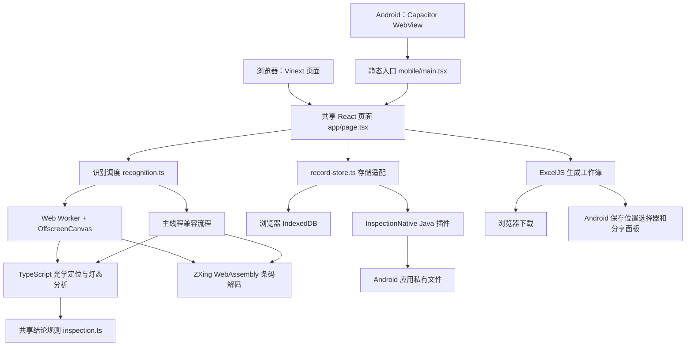
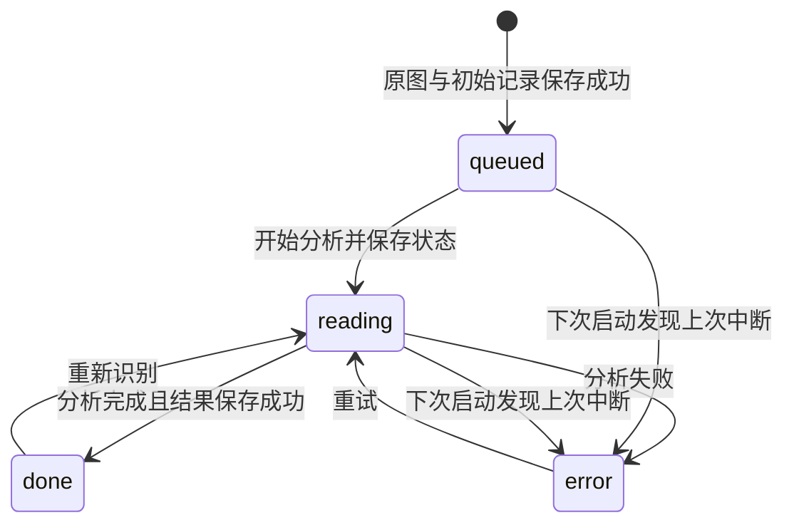

# 检图：技术架构、技术方案与实现说明

本文依据项目当前源码编写，面向维护、交接和二次开发。文档基线为 **Android 1.0.7 / versionCode 8**，核对日期为 **2026-09-09**。后续源码发生变化时，应同步更新本文对应章节。

项目位置：`/Users/apus/Desktop/all-code/inspection-tool`。

**学习核心算法请从 [核心识别与数据处理教程](CORE-RECOGNITION-TUTORIAL.md) 开始。** 教程逐步解释 RGBA 像素、颜色掩码、连通域、机身评分、灯孔搜索、外壳细化、亮灯和串光公式、条码与坐标变换，并提供 b-2 实测数字和可直接运行的实验。本篇保留系统架构与工程实现总览。

相关文档：[使用与构建说明](README.md)、[Android 验证记录](ANDROID-VALIDATION.md)、[项目协作要求](AGENTS.md)。

## 1. 项目定位与业务规则

检图是面向样例蓝盖四灯设备的本地照片分析工具。使用者选择或拍摄照片后，程序定位机身与指示灯、解码试管条形码，展示过程标注和结果，并支持人工校对、本地记录保存及 Excel 导出。

当前实际实现已从最初设想的“A/B/P 文字通过或不通过识别”演变为**设备指示灯状态分析**。输入图片中的文字不是当前结果判定依据。

| 对象 | 当前含义与处理规则 |
| --- | --- |
| Negative | 阴性结果指示灯 |
| Positive | 阳性结果指示灯 |
| Invalid | 无效结果指示灯 |
| Power | 电源灯，仅保留状态展示，不参与结果判定或待确认判断 |
| 三个结果灯 | Negative、Positive、Invalid 互斥，最多一个亮起；无法排除串光时保留待确认 |
| 条形码 | 从条码图案解码，保留前导零；失败时允许人工录入 |
| 人工校对 | 独立记录是否校对；自动识别成功不等同于人工确认完成 |

程序汇总的是设备在照片中的指示状态。它没有病种推断、临床有效性判断或检测仪器控制功能。

## 2. 整体架构

项目采用 **React 共享业务界面 + TypeScript 本地识别模块 + Capacitor Android 容器 + 少量 Java 原生能力** 的架构。两端复用相同的识别、汇总和 Excel 工作簿生成代码。



### 2.1 是否需要后端

**当前识别业务不需要后端服务。** 图片定位、灯态判断、条码解码、结果存储和 Excel 生成均在用户设备上完成，没有业务图片上传 API、远程推理 API 或云端数据库读写流程。

需要区分两类运行环境：

| 环境 | 需要什么 | 不依赖什么 |
| --- | --- | --- |
| 本地网页版 | Node.js 开发工具提供页面及静态资源，浏览器执行识别 | 不依赖远程识别服务器 |
| 安装后的 Android APK | Android 系统、兼容的 WebView、包内页面与 WASM | 不依赖电脑的 localhost、Node.js、外部服务器或首次下载模型 |
| 开发及首次构建 | npm、Gradle、Android SDK 等依赖，首次通常需要联网获取 | 这属于开发环境准备，不是安装后识别的运行依赖 |

`vite.config.ts` 中仍保留 Vinext、Sites、Cloudflare 的开发和构建配置；`.openai/hosting.json` 中 D1、R2 配置均为 `null`。这些模板与构建设施不代表目前使用云端数据库进行检测。

网页版虽然本地执行识别，但仍需能加载网页资源。当前没有实现 Service Worker 离线缓存，因此不能把网页版描述为“关闭网页服务后，也保证可离线重新打开的 PWA”。Android 使用独立静态构建，将资源装入 APK，具备不同的离线加载方式。

### 2.2 为什么两端采用共享实现

`mobile/main.tsx` 直接导入 `app/page.tsx` 和同一份 `app/globals.css`，没有另写一套 Android 检测页面。Android 与浏览器通过 `isAndroid()` 切换选图、拍照、保存和分享的实现。

因此，算法修复通常只需修改共享模块；但交付时仍要重新构建移动端资源并同步到 Android。仅修改网页源码，不会自动改变已安装的 APK。

## 3. 技术选型与代码组织

### 3.0 核心视觉技术到底用了什么：有没有 OpenCV

**当前项目没有使用 OpenCV / OpenCV.js。视觉部分使用浏览器原生图像 API 获取像素，再由项目自己编写的 TypeScript 代码完成机身定位和灯态分析；条码识别则使用第三方 `zxing-wasm` 库。**

理解技术选型时，需要把“运行平台提供的 API”“第三方库”和“本项目自行实现的代码”分开：

| 功能 | 实际采用的技术 | 技术类别 | 具体调用或源码 |
| --- | --- | --- | --- |
| 解码照片 | `createImageBitmap`；兼容路径使用 `HTMLImageElement` | 浏览器 / WebView 原生 API | `recognition.worker.ts`、`recognition.ts` |
| 缩放、旋转、生成预览 | Canvas 2D、OffscreenCanvas | 浏览器 / WebView 原生 API | `drawImage()`、`rotate()`、`convertToBlob()` / `toDataURL()` |
| 提取像素 | Canvas 的 `getImageData()` | 浏览器 / WebView 原生 API | 输出 RGBA `ImageData` |
| 表示与计算像素 | `Uint8ClampedArray`、`Uint8Array`、`Int32Array` | JavaScript 类型化数组 | RGB 读取、掩码、访问标记、整数队列 |
| 机身与灯孔定位 | 项目自写的 TypeScript 视觉代码 | 本项目实现 | `device-vision.ts` |
| 外壳边界细化 | 项目自写的 TypeScript 视觉代码 | 本项目实现 | `body-boundary.ts` |
| 灯态、颜色与串光处理 | 项目自写的 TypeScript 规则代码 | 本项目实现 | `measureLamp()`、`resolveResultLamps()` |
| 条码解码 | `zxing-wasm/reader`，底层为 ZXing-C++ 的 WebAssembly 构建 | 第三方视觉解码库 | `barcode.ts` 调用 `readBarcodes()` |
| 将计算放到界面线程之外 | Web Worker | 浏览器 / WebView 原生 API | `recognition.worker.ts`、`postMessage()` |
| 绘制识别框和标签 | SVG + React | Web 图形技术与界面库 | `components/inspection/analysis-image.tsx` |

因此，“计算机视觉”描述的是任务领域，不代表项目一定依赖 OpenCV。当前颜色筛选、连通域搜索、边缘评分等操作都是 TypeScript 中的数组访问和循环，没有调用 `cv.Mat`、`cv.inRange`、`cv.findContours` 或 `cv.Canny`。也没有使用 TensorFlow、PyTorch、ONNX Runtime、YOLO 或 Android ML Kit 执行模型推理。

Canvas 负责让程序取得或变换图片，不会自动识别机身；Web Worker 负责调度计算，不是识别模型；WebAssembly 是这里运行条码库的技术，不能把它理解为本项目所有视觉算法都已经编译成 WASM。

当前实际执行关系是：

```text
图像文件
  → ImageBitmap / HTMLImageElement 解码
  → Canvas / OffscreenCanvas 缩放与取像素
  → ImageData / Uint8ClampedArray
      ├─ 项目自写 TypeScript → 机身框、灯框、灯态
      └─ zxing-wasm → 条码字符串、制式与位置
  → TypeScript 业务规则汇总
  → React + SVG 展示
```

**Android 的视觉技术与网页相同。** Capacitor 把共享页面装入 Android WebView，识别在本机 WebView 的 JavaScript / Worker / WASM 环境运行。Java 插件负责系统选图、调用系统相机、文件保存等原生能力，没有另写 Java OpenCV 检测器，也没有把识别请求交给服务器。

配套的数据与工程技术如下：

| 方面 | 当前技术 | 职责 |
| --- | --- | --- |
| 业务语言与数据模型 | TypeScript、普通对象与数组 | 定义 Inspection / DeviceVision / Lamp，组织与汇总结果 |
| Web 界面 | React、Tailwind CSS、SVG | 页面状态、浅色样式、结果标注 |
| Web 开发及构建 | Vinext、Vite、Node.js | 提供开发页面并构建资源；Node 不承担生产图片识别 |
| Android 容器与桥接 | Capacitor、Android WebView、Java | 复用网页业务代码并接入系统能力 |
| 网页拍照 | `navigator.mediaDevices.getUserMedia()` | 取得摄像头视频，再用 Canvas 截取照片 |
| Android 拍照 | `ACTION_IMAGE_CAPTURE`、FileProvider | 调用系统相机并取得完整照片文件 |
| 浏览器记录保存 | IndexedDB | 存储原图 Blob 与结构化记录 |
| Android 记录保存 | 应用私有文件、JSON、AtomicFile | 保存图片字节及元数据 |
| Excel | ExcelJS | 生成带缩略图、条码、灯态和明细的 xlsx |
| Android 文件导出 | Capacitor Filesystem / Share、系统文件选择器 | 临时文件、分享面板和保存位置选择 |
| 算法测试中的图像处理 | Sharp | 在 Node 测试中解码、缩放和生成扰动样本，不是手机识别引擎 |

依赖中保留的 `tesseract.js` 是 OCR 库，但当前识别流程没有调用；`@zxing/browser`、`@zxing/library` 也不是当前条码入口。学习时应以实际 import 和函数调用为准，不能仅凭 package.json 中有一个包就认为功能正在使用它。

这套实现利用了样例设备的固定结构，使 Web 与 Android 可以共用一份本地视觉代码。它的代价是定位与判灯规则需要项目自行维护，适用范围受现有设备模板和像素阈值约束。接入 OpenCV 或模型推理属于后续技术改造，并不是当前项目已经具备的能力。

### 3.1 主要技术

下表版本是当前 `package.json` 的声明值或系列；精确安装版本由 `package-lock.json` 锁定。

| 层次 | 技术 | 在本项目中的用途 |
| --- | --- | --- |
| 语言 | TypeScript 5.9.3、Java | 前端与识别业务、Android 原生桥接 |
| 界面 | React 19.2.6 | 照片列表、结果展示、校对和交互状态 |
| Web 开发框架 | Vinext 1.0.0-beta.5、Vite 8.0.13 | 网页开发服务和构建 |
| 移动端静态构建 | Vite、React 插件 | 将共享页面编译为 Android 可直接加载的静态资源 |
| 样式与组件 | Tailwind CSS 4.2.1、Base UI、shadcn、Lucide | 浅色界面、弹窗、选择器、标签页与图标 |
| Android 容器 | Capacitor 8 系列 | WebView、JavaScript 与原生插件通信 |
| 图像处理 | Canvas、OffscreenCanvas、ImageBitmap、TypedArray | 缩放、方向变换、像素读取、局部图像计算 |
| 条码 | zxing-wasm 3 系列 | 在本机运行 ZXing-C++ WebAssembly 解码器 |
| Excel | ExcelJS 4.4 系列 | 生成含照片和检测信息的 `.xlsx` |
| 浏览器存储 | IndexedDB | 保存原始图片 Blob 和记录 |
| Android 存储 | 私有文件目录、AtomicFile | 保存原图字节及 JSON 记录 |
| 原生文件能力 | Storage Access Framework、FileProvider | 选择图片、保存 Excel、传递相机输出和分享文件 |
| 自动测试 | Node.js test、Sharp、fake-indexeddb | 原图回归、图像扰动、Excel 回读、浏览器存储模拟 |

依赖清单中还保留 `tesseract.js`、`@zxing/browser`、`@zxing/library` 等包，但当前业务识别入口没有调用它们。不能据此把现方案写成 OCR、多个条码引擎融合或深度学习识别方案。

### 3.2 关键目录

```text
inspection-tool/
├── app/
│   ├── page.tsx                   # 两端共享的业务页面与流程编排
│   ├── layout.tsx                 # 网页布局和元信息
│   └── globals.css                # 共享浅色样式
├── components/inspection/
│   ├── analysis-image.tsx         # SVG 图片、标注图层和手动框选
│   └── camera-dialog.tsx          # 网页摄像头预览和拍照
├── lib/
│   ├── recognition.ts            # 图片准备、Worker 调度和兼容流程
│   ├── recognition.worker.ts     # Worker 内完整识别流水线
│   ├── device-vision.ts          # 蓝盖、初始机身、灯孔定位及灯态判断
│   ├── body-boundary.ts          # 实际外壳边界细化
│   ├── barcode.ts                # 全图及试管区域条码解码
│   ├── inspection.ts             # 数据类型、结论与校对规则
│   ├── record-store.ts           # Web / Android 存储适配
│   ├── native.ts                 # Capacitor 插件类型及照片读取
│   ├── export.ts                 # 共享工作簿生成和网页下载
│   └── mobile-export.ts          # Android 保存、分享 Excel
├── mobile/                       # Android 静态网页入口
├── public/barcode/               # 随应用分发的条码 WASM 资源
├── android/                      # Android Studio / Gradle 项目
├── scripts/                      # APK 构建、Android 内存采样
├── tests/                        # 自动回归测试
├── test-img/                     # a/b 原图与参考结果图
├── dist-mobile/                  # 自动生成的移动端网页资源
├── releases/                     # APK 与 SHA-256 校验文件
└── signing/                      # 本地正式签名文件，不提交版本库
```

`dist-mobile/`、Android 内复制的网页资源和构建产物不是日常修改入口；应修改源文件，再执行构建与同步。

## 4. 一张照片的完整处理流程

页面中的主要调用关系如下：

```text
选择照片 / 拍照
  → 转为 File[]
  → upload(files)
  → 文件格式、大小与数量检查
  → prepareImage(file)：原图 URL、初始显示信息、列表缩略图
  → saveRecord(queued)：先保存原始照片与初始记录
  → process(batch)：逐张执行
  → 保存 reading 状态
  → recognize(image)
      → 本地原图读取
      → 1024 长边定位图
      → 方向选择、初始机身与灯孔定位
      → 灯态测量、三结果灯串光处理、实际机身边界细化
      → 1536 / 2560 / 4096 条码逐级扫描
      → 1600 长边预览和 240 长边缩略图
  → 保存 done 状态和识别结果，reviewed=false
  → React 页面根据 conclude(device) 展示结论
```

批次通过 `for...of` 和 `await` 顺序处理，没有同时开启 30 个识别任务。`busyRef` 防止重复进入流程，`busy`、`picking`、`exporting` 等状态控制按钮和进度。页面同时维护 `recordRef`，异步回调从最新记录集合取值。

`patch()` 先 `await saveRecord(next)`，成功后才更新 React 中的记录，避免直接把未落盘的数据展示为已保存状态。

### 4.1 输入限制

| 限制 | 当前实现 |
| --- | --- |
| 文件类型 | JPG/JPEG、PNG、WebP，以文件 MIME 类型检查 |
| 单张大小 | 不超过 20 MiB，即 `20 × 1024 × 1024` 字节 |
| 本地数量 | 页面最多保留 30 条；剩余容量不足时仅接收可容纳部分 |
| 图片像素 | `prepareImage()` 读取尺寸后，拒绝超过 6000 万像素的图片 |
| 原生多选 | 单次选择超过 30 张时拒绝 |

像素检查发生在图片加载取得尺寸之后，不是解码前的内存上限保障。文件大小较小的高分辨率压缩图片，解码后仍可能占用较大内存。

### 4.2 状态与失败恢复



`phase='done'` 表示流水线返回结果，不等于条码、定位和结果全部确定。例如，条码解码失败可以保留灯态结果及提示。是否需要人工确认，由条码、校对标志和结论共同决定。

## 5. 图片尺寸、坐标与线程方案

### 5.1 原图、分析图和预览图分开使用

| 图片用途 | 长边上限 | 作用 |
| --- | --- | --- |
| 原始文件 | 保留输入原始字节 | 持久化、重新识别、查看上传原图 |
| 灯态定位图 | 1024 px | 控制像素遍历量，建立检测坐标系 |
| 条码扫描图 | 1536 → 2560 → 4096 px | 小图优先，失败才增加分辨率 |
| 结果预览图 | 1600 px，JPEG 质量 0.9 | 结果页清晰展示与标注叠加 |
| 列表/Excel 缩略图 | 240 px，JPEG 质量 0.8 | 降低列表和工作簿体积 |

这些尺寸是上限。`scale = min(1, max / max(originalWidth, originalHeight))`，不会把较小的原图强行放大到上限。`scanSize` 记录的是本轮选择的扫描档位，实际扫描图尺寸可能小于该档位。

上传后识别尚未结束时，主图直接显示原图 URL，不能把 240 px 缩略图放大作为主图。这是此前“上传后图片变模糊”的修复要点。

### 5.2 坐标系

`Box` 采用 `{x, y, width, height}`，以图像左上角为原点。记录中的 `imageWidth/imageHeight` 是**经过方向选择的分析图尺寸**，不是原始文件尺寸。

灯位框和机身框直接使用该分析图坐标。条码框先在当前扫描图中生成，再映射回分析图：

```text
scaleX = analysisWidth / barcodeScanWidth
scaleY = analysisHeight / barcodeScanHeight

analysisBox.x      = scanBox.x      × scaleX
analysisBox.y      = scanBox.y      × scaleY
analysisBox.width  = scanBox.width  × scaleX
analysisBox.height = scanBox.height × scaleY
```

预览图采用同样的旋转角度。`AnalysisImage` 使用 SVG `viewBox` 展示图片和框，因此页面缩放时图片与标注保持一致。试管区域裁剪解码还会先加回裁剪偏移，不能遗漏这一步。

### 5.3 Worker 与兼容流程

优先路径使用 `RecognitionWorker`，通过 Vite `?worker` 导入生成正确的 Worker 资源地址，避免开发环境把 `import.meta.url` 改写成不可加载的 `file://` 地址。

主线程通过 `postMessage(blob)` 交付照片。Worker 使用 `createImageBitmap()` 和 `OffscreenCanvas` 处理，逐步返回进度，最后返回结构化结果、预览 Blob 和缩略图 Blob。主线程把两个 Blob 转成 Data URL，进入统一保存流程。

以下情况使用主线程兼容流程：

- 不支持 Worker、OffscreenCanvas 或 createImageBitmap。
- Worker 构造失败。
- Worker 加载触发 `onerror`，被归类为 `WorkerUnavailableError`。

一般算法异常和 90 秒 Worker 等待超时会报告失败，不会一律再用主线程重复执行。主线程兼容路径没有同等的 90 秒统一中断机制；其中同步计算也不具备 Worker 的界面隔离能力。

成功的小尺寸扫描会复用 Worker 及解码器。使用到 4096 扫描档位或发生异常时，调度层终止 Worker，以回收较大的解码堆。Worker 在 `finally` 中关闭原始 ImageBitmap；主要预览和扫描画布在使用后清零尺寸。

## 6. 设备定位与灯态识别算法

主要实现：[device-vision.ts](lib/device-vision.ts)、[body-boundary.ts](lib/body-boundary.ts)。

当前方案属于**基于像素特征和设备结构先验的光学规则算法**。它没有 YOLO、神经网络权重、训练过程或推理服务。参数是针对现有样例调整的工程规则，`fitScore` 是内部候选排序分值，不能解释为识别概率或模型置信度。

### 6.1 蓝盖候选提取

对 RGBA 图像构造蓝色掩码，主要条件为：

```text
B > 35
B > 1.4 × R
B > 1.08 × G
B - R > 20
```

随后通过四邻域连通区域遍历计算每个候选的像素数和包围框。进一步按宽高、宽高比、区域填充率、相对图像尺寸和位置筛选，按面积保留最多 8 个候选。

这一步利用蓝盖识别设备附近区域，不能将画面中任意蓝色物体直接当成设备。后续还要结合机身、试管和灯孔排列比较候选。

### 6.2 初始机身与方向选择

`locateBody()` 在蓝盖下方搜索机身矩形。当前搜索使用的比例包括：

- 机身宽约为蓝盖宽的 1.45～2.15 倍。
- 初始机身高约为机身宽的 2.48～2.68 倍。
- 在蓝盖中心附近搜索一定水平和垂直偏移。
- 比较外壳内侧、边缘外侧、底部的亮度变化，再加上试管区域对比和比例惩罚。

候选还会加入成对灯孔的排列证据。这样可以减少桌面上其他蓝色物体或暗色矩形被误选的问题。

`orientDevice()` 分别分析 0°、90°、180°、270°，取分值最高的方向。它没有执行任意角度的完整透视矫正；轻微倾斜主要由局部灯孔校正容忍。现有测试覆盖的 ±5° 不代表任意倾斜或严重透视都可靠。

### 6.3 灯孔自适应定位

初始布局以机身左上角为基准，使用归一化位置：

| 灯位 | 初始中心 x / 机身宽 | 初始中心 y / 机身高 |
| --- | --- | --- |
| Negative | 0.42 | 0.46 |
| Positive | 0.64 | 0.46 |
| Invalid | 0.28 | 0.83 |
| Power | 0.28 | 0.905 |

这组比例只生成搜索先验。1.0.6 起，`locateLampBoxes()` 会在附近查找实际灯孔：

1. 比较中心与周围环形区域的亮度，检测未亮的暗孔。
2. 比较中心与更外圈的色差信号，检测发光孔，并减少宽面积反光干扰。
3. 通过局部峰值抑制，避免同一灯孔产生大量重复候选。
4. 联合匹配 Negative / Positive 的左右顺序、间距、同排关系与相对偏移。
5. 根据匹配的结果灯排位置重新搜索 Invalid，避免仅按原矩形高度推算。
6. Power 仅保留独立展示位置与测量值，不加入三个结果灯的亮灯竞争。

当前默认灯态采样框宽约为初始机身宽的 16%，高约为初始机身高的 7%。定位阶段使用固定采样点和运行中的极值统计，避免逐像素反复进行三角计算和数组排序。

### 6.4 机身外壳边界细化

1.0.7 新增的 `refineBodyBoundary()` 解决了“灯孔已经准确，但机身框仍偏右或截短”的问题。

此步骤在灯位计算之后独立进行：从管盖下方外壳取小块像素的通道中位数，构造颜色特征：

```text
c1 = (R - G) / (G + 30)
c2 = (B - G) / (G + 30)
L  = 0.299R + 0.587G + 0.114B
```

在受限搜索区域内，寻找与种子颜色接近的连通外壳区域；通过有足够像素支持的行估计上下界，再结合左右局部 RGB 边缘和跨行分位数确定外框。这样允许部分行被拇指遮挡，不必把全部左边界缩到手指内侧。

近黑或中性外壳、颜色与背景难以分离、连通区域越界或几何证据不足时，保留初始框。手动框选时直接保留用户给定的矩形，不执行自动外壳扩展。

**细化后的机身展示框与已经确定的灯态采样框分开管理。** 不能在展示框扩大后，重新用固定比例移动全部灯框，否则会再次引入已经修复的灯位偏差。

以 b-2 的 771×1024 分析图为例，外框由约 `(278.5, 511.1, 169.5, 420.5)` 调整为 `(254, 511, 186, 492)`，底边从约 931.5 下移到 1003，覆盖完整外壳。

### 6.5 单灯亮灭和颜色判断

`measureLamp()` 统计灯区的峰值、高亮像素数和色差信号。主要色差定义为：

```text
redSignal   = R - max(G, B)
greenSignal = G - max(R, B)
amberSignal = min(R, G) - B
```

像素成为发光候选的主要条件为下列条件之一：

| 候选 | 门限 |
| --- | --- |
| 红色 | R > 125 且 redSignal > 60 |
| 绿色 | G > 100 且 greenSignal > 30 |
| 黄/橙色 | R > 155、G > 80 且 B < 0.65 × G |

最低发光面积为 `max(4, round(灯框宽 × 灯框高 × 0.025))`。红/黄候选按数量比较该门限；绿色还要求形成连通区域，且至少有 4 个满足更高亮度与色差条件的核心像素。

因此，一个峰值很高的孤立反光像素不能单凭 `peak=255` 被判为亮灯。绿色专门保留较低饱和度的发光候选，用于处理曝光后偏浅、接近白色的绿色灯芯。

`brightPixels` 是候选像素数量，`signal` 是这些候选的平均色差信号，均为图像测量值，不是模型概率。

### 6.6 三结果灯互斥和串光抑制

`resolveResultLamps()` 只比较 Negative、Positive、Invalid 中已达到 ON 门限的候选。对于每个灯，计算：

```text
density = brightPixels / max(1, box.width × box.height)
energy  = density × signal
```

有两个或更多结果灯候选时，若最强候选同时满足：

```text
energy(最强) ≥ 3 × energy(次强)
density(最强) ≥ 2 × density(次强)
```

则保留最强灯 ON，其余候选按较弱串光标为 OFF。不能明显区分时，将这些候选标为 unknown，交给人工核对，不采用 Invalid 优先级，也不固定选 Positive。

Power 始终不在候选集合中。它的亮、灭、未知或记录缺失，不应成为结果有效性条件，也不会产生“电源未亮”的核对警告。

## 7. 条形码技术方案

主要实现：[barcode.ts](lib/barcode.ts)。

条码通过 `zxing-wasm/reader` 解码，WASM 文件从本地 `/barcode/zxing_reader.wasm` 加载。移动构建会把 `public/barcode/` 复制到 `dist-mobile/barcode/`，再随 Capacitor 同步进入 APK。

解码默认启用更充分搜索、旋转尝试和反色尝试，每次最多寻找 8 个符号。算法首先扫描整张图片；没有任何有效结果、且存在管盖定位时，再裁剪蓝盖上方的试管区域扫描。

当前试管裁剪范围大致为：横向从 `cap.x - 0.4 × cap.width` 到 `cap.x + 1.4 × cap.width`，纵向从 `cap.y - 4 × cap.width` 到 `cap.y`，并限制在图片边界内。

1536 档位失败后尝试 2560、4096；解码成功、检测到多个不同编号或已经使用到原图尺寸时停止继续放大扫描。b-5 的漏读通过试管区域重试解决，没有填入已知编号，也没有 OCR 猜数。

| 结果 | 处理 |
| --- | --- |
| 唯一有效编号 | 返回字符串、格式、位置框 |
| 多个不同有效编号 | `ambiguous=true`，不自动选其中一个 |
| 没有有效编号 | 保留未识别提示，可人工录入 |

对弯曲的一维条码，解码位置有时近似一条扫描线。程序会给过窄的框增加可见厚度，便于标注；这个展示框不等于对整张条码标签做了精确分割。

## 8. 数据模型与结论规则

核心类型定义在 [inspection.ts](lib/inspection.ts) 和 [device-vision.ts](lib/device-vision.ts)。

| 类型 | 主要字段 | 用途 |
| --- | --- | --- |
| `PixelFrame` | data、width、height | RGBA 像素输入 |
| `Box` | x、y、width、height | 分析坐标中的矩形 |
| `Lamp` | key、state、color、box、peak、signal、brightPixels、reason、manual | 单灯定位、测量及校对 |
| `DeviceVision` | body、cap、lamps、method、localization、warnings、fitScore | 设备识别结果 |
| `Inspection` | id、name、image、displayImage、thumbnail、barcode、device、phase、reviewed、rotation、elapsedMs 等 | 一张照片的完整记录 |
| `Conclusion` | code、title、summary、tone、warnings | 页面和 Excel 共用的汇总结果 |

`Lamp.state` 有 `on/off/unknown`；`Lamp.color` 有 `red/amber/green/none`。`barcodeSource` 有 `decoded/manual/unread`，区分真实解码与人工录入。

`conclude()` 的主要规则是：多个结果灯 ON 时返回 conflict；机身缺失、三个结果灯记录不完整或仍有未知状态时返回 unknown；随后按唯一亮起的结果灯返回 negative、positive 或 invalid；三个结果灯都未见亮起时返回 unknown。Power 不参与上述完整性检查。

`needsReview(record)` 在以下任一情况为真：尚未人工校对、条码为空、结论为 unknown 或 conflict。程序不会因为点击过校对保存，就把缺少条码或冲突结果当成已确定。

人工选择某个结果灯为 ON 时，`setManualLampState()` 自动把另外两个结果灯设为 OFF，并记录人工修改原因；修改 Power 不会联动结果灯。重新识别会重算图像结果并将 `reviewed` 设回 false。

## 9. 本地持久化与数据恢复

### 9.1 浏览器

IndexedDB 数据库名称为 `jiantu-inspections`，版本为 1，对象仓库为 `records`，主键是 `id`。每项存储：

```ts
type StoredRecord = {
  id: string;
  record: Inspection;
  original: Blob;
};
```

首次保存写入原始 Blob；后续更新复用已经保存的原图，更新元数据。写操作等待事务完成。`blob:` URL 只在当前页面生命周期内有效，因此保存前会清空 `record.image`，恢复时从原始 Blob 重新生成 URL。

数据属于当前浏览器及站点 origin。不同浏览器、不同端口或不同主机名不自动共享同一份 IndexedDB。清除站点数据会丢失记录，程序未实现云端同步。

### 9.2 Android

`InspectionNativePlugin` 在 `getFilesDir()/inspections/` 中存储：

```text
<record-id>.image  # 输入图片原始字节，扩展名统一为 .image
<record-id>.json   # Inspection 元数据，不持久化临时显示 URL
```

初次写入时先保存原图，再保存 JSON。更新结果时通常只发送 JSON；`storedIds` 是本次运行中的优化集合，不是持久化索引。Java 端仍检查原图文件存在。

原生侧使用 `AtomicFile` 保护单个文件的写入；**原图和 JSON 两个文件并不是跨文件原子事务**。读取时逐条检查，坏记录给出警告并保留原文件。这里没有 SQLite、Room 或云端数据库。

记录 ID 只允许字母、数字和连字符，长度 1～80；JSON 写入前做语法解析。当前没有完整的业务字段 schema 校验、算法版本迁移或自动重新分析机制。

### 9.3 启动恢复与删除

启动时执行 `loadRecords()`，按 `createdTimestamp` 排序。恢复到 queued 或 reading 的旧记录会转为 error，并提示上次分析中断，原图可用于重试。

如果旧记录的主预览误用了缩略图且符合恢复条件，则改为原图显示。历史算法结果不会因升级 APK 自动重算，通常需要点击“重新识别”。

删除先执行持久化删除，成功后更新界面并释放 URL。卸载 Android 应用或清除应用数据会删除私有记录；Manifest 设置 `allowBackup=false`。Excel 只带缩略图和结果，不能作为恢复全部原始照片档案的导入备份。

## 10. 选图、拍照和原生桥接

### 10.1 网页输入

网页选图通过文件输入控件和拖放进入同一个 `upload()` 流程。摄像头实现位于 `camera-dialog.tsx`，使用 `getUserMedia()`，不请求音频，优先请求后置镜头，理想分辨率为 2560×1920。

理想分辨率不保证设备实际提供该尺寸；拍照使用视频实际的 `videoWidth/videoHeight` 生成 JPEG，质量为 0.95。支持切换镜头、取消、权限错误、设备缺失和占用提示，并设置 20 秒启动超时。关闭或切换镜头时停止媒体轨道。

浏览器相机通常需要安全上下文，项目提示使用 HTTPS 或 localhost。网页摄像头入口与 Android 系统相机入口是两种实现，不能互相当作设备验证证据。

### 10.2 Android 原生插件

`MainActivity` 继承 Capacitor `BridgeActivity`，注册 `InspectionNativePlugin`。JavaScript 在 `lib/native.ts` 通过 `registerPlugin('InspectionNative')` 调用它。

| 插件方法 | 实现 |
| --- | --- |
| `pickPhotos()` | ACTION_OPEN_DOCUMENT，多选，限制 JPEG/PNG/WebP |
| `takePhoto()` | ACTION_IMAGE_CAPTURE，指定完整照片输出 URI |
| `clearImports()` | 清理临时导入文件 |
| `putRecord()` | 保存原图与 JSON |
| `listRecords()` | 读取记录、返回本地图片 URI 和逐条错误 |
| `deleteRecord()` | 删除记录及原始图片 |
| `saveExcel()` | ACTION_CREATE_DOCUMENT，让用户选择保存位置 |

选图结果首先复制到 `cache/imports/`，JavaScript 通过 `Capacitor.convertFileSrc()` 读取为 Blob，再包装为 File，最后清理导入缓存。因此长期记录不依赖原始相册 URI 持续可访问。

拍照创建 `cache/imports/camera-*.jpg`，通过 FileProvider 和 `MediaStore.EXTRA_OUTPUT` 传给系统相机。成功后读取完整输出文件，不读取 Intent 中可能仅有的缩略图。取消拍照返回空列表并删除临时文件；回调撤销临时 URI 访问授权。

当前 Manifest 未声明相机、互联网或全盘存储权限。相机由外部系统相机应用完成，文件由系统选择器授权访问；这不同于在应用内直接使用 CameraX 或 Camera2。

FileProvider 仅映射 `cache/exports/` 和 `cache/imports/`，没有映射全部应用私有记录目录。原生记录目录与对外临时文件目录分离。

## 11. Excel 生成、保存与分享

两端都调用 `createWorkbook(records)`，避免页面与导出各自实现一套判定规则。调用 `conclude()` 生成综合指示、`needsReview()` 生成校对状态。

| 工作表 | 内容 |
| --- | --- |
| 检测汇总 | 序号、照片缩略图、文件名、条码、条码来源、综合指示、四路灯态、校对状态、耗时、时间、提示 |
| 灯态分析明细 | 每个灯的状态、颜色、峰值、高亮数量、色差、判定依据、坐标和是否人工校对 |

条码按字符串写入，单元格数字格式设置为 `@`，防止 Excel 去掉前导零。照片使用 240 px 缩略图嵌入，表头冻结并设置筛选。Power 列明确标为“电源，仅展示”，未知时显示“未识别”，不因此增加综合核对提示。

网页版通过 Blob、临时下载链接和 `<a download>` 下载，稍后释放 URL。Android 先将文件写入 `cache/exports/`：保存时使用系统保存位置选择器复制文件；分享时由 Capacitor Share 打开系统分享面板。

旧导出缓存会在后续导出时按超过 24 小时的条件清理，不是后台定时清理任务。打开分享面板不代表已发送，用户仍需选择接收应用并完成该应用的操作。

页面目前导出记录集合，而不是仅导出当前选中的一张照片。

## 12. 性能与资源使用

当前已有的控制措施包括顺序处理、1024 定位图、条码逐级扫描、Worker 隔离、有限解码器复用、原图与预览分工，以及位图、画布和 URL 的生命周期管理。

图像内存不能按 JPEG 文件大小估计。RGBA 像素数组近似占用 `宽 × 高 × 4` 字节，一张 3072×4096 图片的一份 RGBA 数据约为 48 MiB；原始位图、Canvas、WASM 堆和中间缓冲区同时存在时总占用还会增加。Android 首次保存原图还会经过 Base64 桥接，Base64 字符数量约为原始字节数的 4/3，实际内存还取决于字符串表示与复制过程。

原生多选会先返回一批 File，页面也会准备整批记录；“识别串行”不等于“内存中只保留一张原图”。30 张上限是数量限制，不是已经证明安全的内存预算。

Worker 返回 `loadMs/locateMs/barcodeMs/previewMs/scanSize`，用于诊断阶段耗时。记录 `elapsedMs` 主要覆盖 `recognize()` 调用内的读取、计算和预览结果转换，不包含用户选图等待及最终持久化时间。

`scripts/android-memory.py` 通过 adb 采样应用进程及关联 WebView renderer 的 PSS。它是调试辅助脚本，不是应用中的常驻监控模块；采样也可能漏掉瞬时峰值。

## 13. 构建、Android Studio 与双端同步

### 13.1 本地开发

```sh
cd /Users/apus/Desktop/all-code/inspection-tool
npm ci
npm run dev -- --host :: --port 3000
```

在浏览器打开 `http://localhost:3000/`。这里的 Node.js 用于提供开发页面和模块，不承担图片识别服务。手机上的 localhost 指向手机自身，不能用它访问电脑的开发服务；正式 APK 不需要访问这个地址。

### 13.2 质量检查与构建命令

```sh
npm test
npm run typecheck
npm run build
npm run apk:release
```

`npm run build` 是网页版构建；`npm run start` 使用 Wrangler 加载该构建的配置。Android 使用不同的静态构建链路：

```text
npm run apk:release
  → npm run android:sync
      → npm run build:mobile
          → Vite 构建 mobile/main.tsx
          → 输出 dist-mobile/
          → 复制本地条码资源
      → cap sync android
          → 复制到 android/app/src/main/assets/public/
          → 同步 Capacitor 插件配置
  → node scripts/build-apk.mjs release
      → Gradle :app:assembleRelease
      → 复制到 releases/jiantu-<versionName>-release.apk
      → 生成同名 .sha256 文件
```

### 13.3 Android Studio 运行

开发环境使用 Node.js 22.13+、JDK 21 和 Android SDK 36。Android 项目配置为 minSdk 24、compileSdk 36、targetSdk 36；实际可运行性还受系统 WebView 能力影响。

先在项目根目录执行 `npm run android:sync`，再用 Android Studio 打开 **`inspection-tool/android`**，选择 JDK 21 完成 Gradle 同步，连接设备或启动模拟器，然后运行 `app`。

修改共享网页或算法源码后，需要再次执行 `npm run android:sync` 再运行 Android。只点 Android Studio 的 Run 不会自动重新执行 Vite 构建。

`scripts/build-apk.mjs` 优先使用有效的 `JAVA_HOME`，否则尝试 macOS Android Studio 自带 JDK。SDK 使用 `ANDROID_HOME`，否则尝试当前用户的 `Library/Android/sdk`。

### 13.4 版本与签名

当前包名为 `com.jiantu.inspection`，Android 版本为 1.0.7 / 8。根目录 `package.json` 的 0.1.0 是 npm 工程版本，不是 APK 安装升级版本；APK 文件名从 Gradle 的 `versionName` 读取。

后续正式更新必须增加 `versionCode/versionName`，并沿用 `signing/jiantu.jks`。签名目录不提交版本库，也不能在文档中记录密码。已有正式包的密钥丢失时，应恢复原备份，不能重新生成密钥后声称可覆盖升级。

构建脚本只在签名文件全部不存在时执行首次初始化；只缺少部分签名文件时会报错。调试包与正式包签名不同，不能作为彼此的覆盖升级包。

功能改动按 [AGENTS.md](AGENTS.md) 同步交付两端，并检查 APK 内资源与 `dist-mobile/` 一致。单纯增加说明文档不改变应用运行代码，无需因此提升 APK 版本或重新打包。

## 14. 测试体系与证据范围

`tests/run.cjs` 先将相关 TypeScript 模块编译为 CommonJS，再使用 Node.js 内置测试运行器执行。Sharp 负责测试中的原图解码、缩放、曝光和旋转；它不是 Android 运行时依赖。

| 测试文件 | 主要覆盖 |
| --- | --- |
| `inspection.test.cjs` | a 系列原图、绿色灯、反光、串光互斥、结论、人工校对、条码与 Excel 回读 |
| `bad-cases.test.cjs` | 6 张 b 系列原图、实际灯孔框、条码回退、尺寸/曝光/倾斜/旋转、Power 与合成灯态变化 |
| `body-boundary.test.cjs` | b-2 四条外边缘与完整底部、不同尺寸曝光方向、其他外壳、人工框选 |
| `record-store.test.cjs` | fake-indexeddb 中的原图保存、结果修改、中断恢复和删除 |

当前 1.0.7 验证记录为 **28 项自动测试通过**，其中一些测试包含多个图片变体，并非只有 28 张输入。b-2 外框与人工标注的 IoU 检查只说明指定样本的几何吻合程度，不是通用模型准确率。

测试图与参考结果位于 `test-img/`、`tests/fixtures/`；测试输出写入忽略目录 `test-output/`。它们不作为安装包中的查表数据，识别代码没有通过文件名或已知条码填充结果。

验证应分层理解：

- 自动测试验证共享算法和部分存储、工作簿逻辑，不等同于真实 WebView、相机或系统文件选择器测试。
- 构建、签名和包内资源一致性检查验证交付产物，不等同于 Android 真机运行。
- 历史 1.0.0 有断网首次运行、选图、保存/分享 Excel、结果保存后强制停止恢复的模拟器记录。
- 1.0.3 相机拍照没有完成真实系统相机拍摄回传验证；浏览器出现预览弹窗也不等于已取得摄像头照片。
- 1.0.7 未新增真机、模拟器或浏览器上传交互实测，不能把旧版本性能数据当成最新版实测数据。

详细环境、版本、样本和证据见 [ANDROID-VALIDATION.md](ANDROID-VALIDATION.md)。

## 15. 当前边界与后续扩展位置

当前算法主要适配蓝盖四灯样例设备。严重透视、遮挡、模糊、复杂反光、其他外壳颜色或不同灯位布局，可能导致定位失败或需要人工核对。自动外壳细化有明确回退条件，不保证所有背景都能完成准确分割。

目前没有云端同步、账号体系、多设备共享、Excel 导入恢复、任务后台续跑、识别模型自动更新或完整记录 schema 迁移。窗口关闭或系统杀进程会中断尚未完成的分析；恢复逻辑提示重试，不会自动从某个计算步骤续算。

后续若扩大设备范围，可在现有模块边界上演进：

| 目标 | 建议修改位置与条件 |
| --- | --- |
| 支持新设备型号 | 将 `lampDefinitions`、盖体与外壳比例等拆成型号模板，并加入新型号的真实标注样本 |
| 降低严重倾斜影响 | 在 `device-vision.ts` 前增加方向/透视归一化，并保持条码、灯位和预览坐标一致 |
| 引入训练模型 | 替换或补充定位模块，保留 `DeviceVision` 输出接口；同时评估离线模型体积、WebView 兼容性和内存 |
| 批量重算旧记录 | 增加算法版本字段、明确人工校对结果保留策略，再设计可中断的重算队列 |
| 大量记录或低内存设备 | 限制在内存中的原图数量，改进原生与 JS 字节传递，评估分页读取与图片独立管理 |
| 多设备共享 | 新增账号、服务端数据接口和冲突处理；这将改变当前无业务后端的架构 |
| 完整备份恢复 | 单独设计原图、元数据、版本和校验清单的导入导出格式，不能直接把现有 Excel 当作档案备份 |

这些属于可演进方向，不是当前已经实现的能力。每次算法调整都应补充对应真实失败样例的回归，并同时验证已有 Negative、Positive、Invalid、Power 规则及网页版/Android 共用代码。

## 16. 常见问题定位入口

| 现象 | 优先检查 |
| --- | --- |
| 上传后主图模糊 | `displayImage` 是否误用 thumbnail；`prepareImage()` 和 `recover()` |
| 识别线程加载失败 | `?worker` 构建产物、资源路径、Worker 构造与 onerror 回退 |
| 灯位框偏移 | 初始机身、`locateLampBoxes()` 的实际灯孔证据、方向与坐标映射 |
| 机身外框截短或包含手指 | `refineBodyBoundary()` 的颜色种子、连通范围、边缘统计与回退条件 |
| 多个结果灯被判亮 | `measureLamp()` 的区域测量及 `resolveResultLamps()` 的密度/色差比较 |
| Power 干扰结果 | 检查是否绕过 `conclude()` 或错误把 Power 加入结果灯集合 |
| 条码漏读 | WASM 是否随包加载、扫描档位、管盖定位、试管裁剪与坐标偏移 |
| 网页正确但 Android 仍旧 | 是否重新执行 android:sync；设备安装版本是否与源码一致 |
| 重启后数据丢失 | IndexedDB origin、应用数据是否被清除、原图/JSON 是否成功落盘 |
| 校对或旧图看起来没更新 | 自动识别不会主动重算旧结果；检查是否重新识别并保存成功 |
| Excel 前导零丢失 | 是否保留 String 条码和 `@` 单元格格式 |
| 修改后出现回归 | 先运行相关测试，再完成全量必要检查；查看源码而非直接修补生成目录 |
